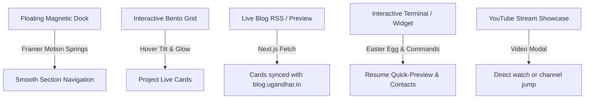

# 🌐 Master Blueprint: Ugandhar Vaddi Portfolio (`ugandhar.in`)

> **Goal**: Build an ultra-responsive, dynamic, high-polish portfolio for **Ugandhar Vaddi** that matches the fluidity, micro-interactions, and interactive dock of [ayush101.dev](https://ayush101.dev), while staying in complete harmony with the Material Design 3 Emerald/Forest aesthetic and typography of [blog.ugandhar.in](https://blog.ugandhar.in).

---

## 1. 🔍 Gathered Information & Verification Checklist

To eliminate any hallucinations, here is the complete breakdown of information gathered from your LinkedIn profile, uploaded screenshots, resume (`Data Science.pdf`), GitHub (`@uga961`), YouTube (`@uga961`), Reddit, and live blog:

### A. Core Bio & Identity
* **Name**: Ugandhar Vaddi
* **Tagline / Headline**: Associate Data Scientist & Software Engineer | Exploring Resilient Systems, Machine Learning & Embedded Hardware
* **Motto**: *"Build, Ship and Sleep"*
* **Location**: Visakhapatnam & Chennai, India
* **Primary Contact**: `annajiratnam@gmail.com`
* **Social & Web Links**:
  * **Website / Domain**: [ugandhar.in](https://ugandhar.in)
  * **Blog**: [blog.ugandhar.in](https://blog.ugandhar.in)
  * **GitHub**: [github.com/uga961](https://github.com/uga961)
  * **LinkedIn**: [linkedin.com/in/vaddi-ugandhar](https://www.linkedin.com/in/vaddi-ugandhar/)
  * **YouTube**: [youtube.com/@uga961](https://www.youtube.com/@uga961) (Python, Pandas, tech guides & creative films)
  * **Reddit**: [reddit.com/user/uga961](https://www.reddit.com/user/uga961/)
  * **HackerRank**: [hackerrank.com/profile/42130516_ECE](https://www.hackerrank.com/profile/42130516_ECE)

---

### B. Education (Verified from LinkedIn & Documents)
1. **Sathyabama Institute of Science & Technology, Chennai**
   * *Degree*: Bachelor of Engineering (B.E.), Electronics and Communication Engineering (ECE)
   * *Duration*: Aug 2022 – May 2026
   * *Grade*: **9.2 CGPA**
   * *Key Focus*: Embedded Systems, VLSI CAD, RTL Design, Data Structures
2. **Sri Viswa Junior College, Visakhapatnam**
   * *Program*: Intermediate (MPC)
   * *Duration*: Oct 2020 – Jul 2022
   * *Grade*: **96.1%** (Board of Intermediate Education, AP)
3. **Suresh High School**
   * *Program*: 10th Standard / SSC
   * *Duration*: Feb 2019 – Mar 2020
   * *Grade*: **10.0 GPA (10 points)**

---

### C. Professional Experience & Internships
1. **McKinsey & Company** — *Research and Insights Intern*
   * *Duration*: Nov 2025 – Jun 2026 (8 mos) | Chennai, India (On-site)
   * *Group*: Ops.Cleansheet
   * *Work*: Building analytics pipelines and LLM-assisted tools for internal operations.
2. **Cognizant** — *DotNet Full Stack Engineer (FSE) Apprentice*
   * *Duration*: Jun 2025 – Aug 2025 (3 mos) | Remote
   * *Program*: Cognizant DN 4.0 Program (.NET Core, C#, Web APIs).
3. **MachCent Aerospace Pvt. Ltd.** — *UAV Embedded Designer Intern*
   * *Duration*: Mar 2025 – Jul 2025 | On-site
   * *Work*: UAV hardware controllers, embedded sensor interfacing, telemetry.
4. **HCLTech** — *System Programming Apprentice*
   * *Duration*: Feb 2025 – Jun 2025 (5 mos) | Chennai, India (On-site)
   * *Group*: HCL CoE (System Programming, Linux Kernel primitives, low-level tooling).
5. **Bharath Intern Pvt. Ltd.** — *Data Science / Machine Learning Intern*
   * *Duration*: Nov 2023 – Jan 2024 (Remote)

---

### D. Featured Projects Portfolio
| Project | Stack | Highlights & Role |
| :--- | :--- | :--- |
| **StayActive** | C#, WPF, .NET | Gentle desktop companion for mindful, step-by-step breaks, hydration & posture. Detailed in a featured essay on `blog.ugandhar.in`. Open-source on GitHub. |
| **Personal Engineering Blog** | Next.js 15, Tailwind, React 19, MDX | High-performance Material Design 3 editorial blog with dynamic reading time, category filters, and Spotify rotation integration. |
| **DtV Lab’s AI Tools** | Python, GenAI / LLMs, Vector Search | Internal AI tools developed during McKinsey engagement for design-to-value automation. |
| **Smart Tool for Engineering Drawings** | Python, Computer Vision, LLMs | Automated parsing and interpretation of engineering schematics. |
| **High Performance SRAM Design** | Cadence Virtuoso, VLSI CAD, RTL | Final Year Project at Sathyabama (with Naralasetti Umesh). Energy-efficient SRAM architectures. |
| **Sexual Harassment Classification** | Python, scikit-learn, TF-IDF, NLP | Multi-class NLP classifier (Commenting, Staring, Touching) reducing false positives by 18%. |
| **Audio Transmission Using Li-Fi** | Visible Light Comm, Solar Cells, ECE | Real-time audio transmission over visible light carrier frequencies. |
| **3D Maze Game** | Unity Hub, C#, Blender | Optimized 15+ 3D assets, refined game loop stability by 30%. |
| **Arduino Safety Radar** | Arduino IDE, Processing 3, Sensors | Ultrasonic real-time radar mapping on desktop GUI. |

---

## 2. 🎨 Design Language & Aesthetic Harmony

Your blog at `blog.ugandhar.in` already has a distinctive, sophisticated design identity. We will adopt the exact same aesthetic foundation so navigating between `ugandhar.in` and `blog.ugandhar.in` feels like a single cohesive ecosystem:

### Exact Palette (Direct from `blog.ugandhar.in`)
* **Dark Mode (Default & Primary)**:
  * Background: `hsl(160 7% 7%)` — Deep muted forest obsidian
  * Surface Low / Cards: `hsl(160 6% 10%)`
  * Surface Container / Hover: `hsl(160 5% 11%)` to `hsl(160 4% 15%)`
  * Primary Accent: `hsl(155 60% 65%)` — Luminous mint green (Material 3 Emerald)
  * Outline / Border: `hsl(150 4% 26% / 0.35)` — Subtle glass hairline border
  * Text Primary: `hsl(140 5% 88%)`
  * Text Secondary / Variant: `hsl(150 7% 77%)`
* **Light Mode Support**:
  * Background: `hsl(140 18% 98%)` — Soft sage-tinted parchment
  * Primary Accent: `hsl(162 100% 21%)` — Deep evergreen

### Typography
* **Primary Sans**: `Geist` (`--font-geist-sans`) — Crisp, technical, modern
* **Monospace**: `Geist Mono` (`--font-geist-mono`) — Code snippets, tags, dates
* **Editorial / Quote Serif**: `Newsreader` (`--font-newsreader`) — For distinctive personal touch & philosophy quotes

---

## 3. ⚡ ayush101.dev Features & Animation Spec

Here is what gives `ayush101.dev` its fluid, standout feel, and how we implement each:



1. **Floating Interactive Dock**:
   * Fixed at screen bottom (or top on mobile) with frosted backdrop blur (`backdrop-blur-md bg-surface/80 border border-outline/30`).
   * Icons: Home, About, Experience, Projects, YouTube, Blog, Contact, Theme Toggle.
   * Icon magnification on hover using Framer Motion springs (`useMotionValue` + `useTransform`).
2. **Bento Grid Architecture**:
   * Hero with live status pill: `🟢 Available for innovative roles & collaborations`.
   * Dynamic Project Cards featuring preview thumbnails, tech pill badges, GitHub button, and live demo buttons.
   * Interactive "Currently Building" widget showcasing *StayActive* with download / repo link.
3. **Micro-Interactions**:
   * Radial cursor spotlight effect across card grids.
   * One-click "Copy Email" with celebratory check animation and tooltip.
   * Interactive Terminal drawer or Quick Command palette (`Cmd+K` / `Ctrl+K`).
   * Embedded YouTube preview drawer for your latest tutorials and short films.

---

## 4. 📁 How to Organize & Provide Your Assets

You can organize your files directly inside `d:\Portfolio\public\` (or root) using this clean structure:

```text
d:\Portfolio\
├── public\
│   ├── avatar\
│   │   ├── profile.jpg          <-- High-res square photo/headshot of you (e.g., 800x800)
│   │   └── avatar-memoji.png    <-- Optional cartoon or casual avatar if you have one
│   ├── resume\
│   │   └── Ugandhar_Vaddi_Resume.pdf  <-- Your latest resume (we can also link Data Science.pdf)
│   ├── projects\
│   │   ├── stayactive\
│   │   │   ├── cover.png        <-- Main banner / preview screenshot (16:9 or 1200x675)
│   │   │   ├── screen1.png      <-- Extra screenshot 1
│   │   │   └── screen2.png      <-- Extra screenshot 2
│   │   ├── blog\
│   │   │   └── cover.png        <-- blog.ugandhar.in screenshot
│   │   ├── sram\
│   │   │   └── schematic.png    <-- Cadence Virtuoso / 6T SRAM screenshot or diagram
│   │   ├── harassment-ml\
│   │   │   └── confusion_matrix.png <-- Model results / charts
│   │   ├── lifi\
│   │   │   └── hardware.jpg     <-- Hardware setup or diagram
│   │   └── radar\
│   │       └── radar_ui.png     <-- Processing 3 radar screen
│   └── social\
│       └── og-image.png         <-- OpenGraph preview for Twitter/LinkedIn (1200x630)
```

> [!TIP]
> Don't worry if you don't have all screenshots right now! We will write elegant placeholder UI cards with vector icons, tags, and code badges, and they will automatically update as soon as you drop the images into the folders.

---

## 5. 🛠 Implementation Roadmap & Tech Stack

* **Framework**: Next.js 15 (App Router) + React 19 + TypeScript
* **Styling**: Tailwind CSS with custom MD3 Emerald theme matching `blog.ugandhar.in`
* **Animations**: Framer Motion (`motion/react`) for spring-physics dock, stagger-in hero, and card tilt
* **Icons**: `lucide-react` & `react-icons` (Simple Icons for GitHub, LinkedIn, YouTube, Reddit, Spotify)
* **Deployment**: Vercel (custom domain mapping to `ugandhar.in`)

### Step-by-Step Milestones:
1. **Verification**: You review Section 1 above and approve the details / highlight any changes.
2. **Project Setup**: Initialize Next.js 15 with TypeScript, Tailwind, Lucide, Framer Motion, and import the exact color tokens from your blog.
3. **Core Components**:
   - Navigation Dock (Framer Motion magnified hover)
   - Hero Section with animated tagline & social pill links
   - Experience & Education Interactive Timeline (McKinsey, Cognizant, HCLTech, Sathyabama)
   - Featured Projects Bento Grid (StayActive spotlight, ML, VLSI, Web)
   - Writing / Blog Integration (Live card previews linking to `blog.ugandhar.in`)
   - YouTube & Media Showcase (Channel link & embedded modal)
   - Contact & Footer
4. **Local Verification**: Run `npm run dev`, verify responsiveness across mobile, tablet, and ultra-wide.
5. **Vercel Shipping**: Push to GitHub and connect `ugandhar.in`.
